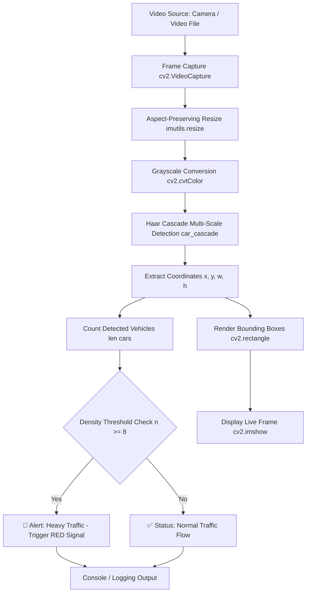

# 🚗 Real-Time Vehicle Detection and Traffic Density Management System

[](https://www.python.org/)
[](https://opencv.org/)
[](https://opensource.org/licenses/MIT)
[](https://github.com/AhryRaj/Vehicle_Detection_And_Tracking)
[](https://github.com/AhryRaj/Vehicle_Detection_And_Tracking)

> An edge-friendly, real-time Computer Vision system for vehicle detection, traffic density monitoring, and dynamic traffic signal alert automation using OpenCV and Haar-Cascade classifiers.

---

## 📌 Table of Contents

- [Overview](#-overview)
- [Key Features](#-key-features)
- [System Architecture](#-system-architecture)
- [Repository Structure](#-repository-structure)
- [Prerequisites & Requirements](#-prerequisites--requirements)
- [Installation & Setup](#-installation--setup)
- [Usage Guide](#-usage-guide)
  - [Running with Live Camera Stream](#running-with-live-camera-stream)
  - [Running on Recorded Video Files](#running-on-recorded-video-files)
- [Configuration & Tuning](#-configuration--tuning)
- [How It Works](#-how-it-works)
- [Troubleshooting & FAQs](#-troubleshooting--faqs)
- [Roadmap & Future Enhancements](#-roadmap--future-enhancements)
- [Contributing](#-contributing)
- [License](#-license)
- [Author & Contact](#-author--contact)

---

## 📖 Overview

Urban traffic congestion is a growing challenge in modern smart cities. Traditional fixed-time traffic light controllers operate on static schedules, failing to adapt to real-time traffic surges, leading to bottlenecks and prolonged commute delays.

This project delivers a **lightweight, real-time vehicle detection and automated density analysis pipeline**. Leveraging OpenCV's pre-trained Haar Cascade classifier, the system continuously parses camera feeds, identifies vehicles across varying scales, monitors traffic density, and triggers proactive signals to balance intersection loads without demanding high-end GPU hardware.

---

## ✨ Key Features

- 🚘 **Real-Time Vehicle Detection**: Identifies moving and stationary cars from live video feeds with low latency.
- 📊 **Dynamic Vehicle Density Counting**: Calculates instantaneous vehicle volume per frame.
- 🚦 **Intelligent Signal Alerting**: Automatically issues recommendations (e.g., triggering red/green signal switching) when traffic surpasses predefined density thresholds.
- ⚡ **Lightweight & Edge-Ready**: Built with CPU-optimized Haar Cascade classifiers, making it ideal for edge computing devices such as Raspberry Pi, Jetson Nano, or standard laptops.
- 🎥 **Flexible Input Streams**: Supports built-in webcams, external USB/CCTV cameras, RTSP streams, and pre-recorded video files.

---

## 🏗️ System Architecture

The following diagram outlines the end-to-end computer vision and decision pipeline:



---

## 📂 Repository Structure

```text
Vehicle_Detection_And_Tracking/
├── cars.xml            # Pre-trained Haar Cascade XML model for car detection
├── Main-Webcam.py      # Core processing script for live feed capture & analysis
├── requirements.txt    # Python package dependencies
└── README.md           # Comprehensive project documentation
```

---

## ⚙️ Prerequisites & Requirements

- **Python**: Version `3.8` or newer
- **Operating System**: macOS, Linux, or Windows
- **Hardware**: Standard webcam or external video capture device (No dedicated GPU required)

### Core Dependencies

- [`opencv-python`](https://pypi.org/project/opencv-python/): Real-time computer vision and image processing.
- [`imutils`](https://pypi.org/project/imutils/): Utility functions for streamlined resizing, perspective shifting, and frame operations.

---

## 🚀 Installation & Setup

1. **Clone the Repository**:
   ```bash
   git clone https://github.com/AhryRaj/Vehicle_Detection_And_Tracking.git
   cd Vehicle_Detection_And_Tracking
   ```

2. **Create and Activate a Virtual Environment** *(Recommended)*:
   - **On macOS / Linux**:
     ```bash
     python3 -m venv venv
     source venv/bin/activate
     ```
   - **On Windows**:
     ```powershell
     python -m venv venv
     .\venv\Scripts\activate
     ```

3. **Install Dependencies**:
   ```bash
   pip install --upgrade pip
   pip install -r requirements.txt
   ```

---

## 💻 Usage Guide

### Running with Live Camera Stream

Execute the main detection script:
```bash
python Main-Webcam.py
```

- Press <kbd>ESC</kbd> while focused on the display window to terminate the application gracefully.

> [!TIP]
> **Camera Index Configuration**:
> If your system uses a built-in camera, the index is usually `0`. If using an external USB webcam, it may be `1` or `2`.
> In [Main-Webcam.py](file:///Users/ahryraj/personal_projects/Vehicle_Detection_And_Tracking/Main-Webcam.py#L10), adjust:
> ```python
> cam = cv2.VideoCapture(0)  # Change 1 to 0 for default internal webcam
> ```

### Running on Recorded Video Files

To test the model on a stored `.mp4` or `.avi` video file instead of a live camera:
1. Replace line 10 in [Main-Webcam.py](file:///Users/ahryraj/personal_projects/Vehicle_Detection_And_Tracking/Main-Webcam.py#L10):
   ```python
   cam = cv2.VideoCapture("path/to/traffic_sample.mp4")
   ```
2. Run the script as usual:
   ```bash
   python Main-Webcam.py
   ```

---

## 🎛️ Configuration & Tuning

You can fine-tune detection sensitivity and alert logic in [Main-Webcam.py](file:///Users/ahryraj/personal_projects/Vehicle_Detection_And_Tracking/Main-Webcam.py):

| Parameter | Current Setting | Description & Optimization Advice |
| :--- | :--- | :--- |
| **Frame Width** | `width=1000` | Controls resolution. Lowering to `640` or `800` increases frame rate on lower-end hardware. |
| **`scaleFactor`** | `1.1` | How much the image size is reduced at each image scale. `1.05` increases sensitivity (slower); `1.2` speeds up detection. |
| **`minNeighbors`** | `1` | Number of neighbor rectangles needed to retain a detection. Increase to `3` or `4` to minimize false positives. |
| **Traffic Threshold** | `n >= 8` | Density threshold triggering traffic signal recommendations. Customize based on road lane capacity. |

Example tuned snippet:
```python
# Balanced speed and precision with fewer false positives:
cars = car_cascade.detectMultiScale(
    gray,
    scaleFactor=1.15,
    minNeighbors=3,
    minSize=(30, 30)
)
```

---

## 🔬 How It Works

1. **Haar-like Feature Evaluation**: The classifier relies on Haar features (edge, line, and four-rectangle features) to detect structural contrasts characteristic of automobiles (windshields, roofs, tires, bumpers).
2. **Integral Image Transformation**: Rapid feature evaluation is accomplished via integral image representations, ensuring constant-time box area sums.
3. **Cascade Architecture**: Weak classifiers trained via AdaBoost are structured into a multi-stage cascade. Sub-windows lacking vehicular features are discarded in early stages, reserving processing power for candidate regions.
4. **Traffic Signal Decision Engine**: Instantaneous counts are aggregated frame-by-frame, serving as real-time feedback for dynamic traffic management controllers.

---

## ❓ Troubleshooting & FAQs

<details>
<summary><b>1. Error: <code>cv2.error: (-215:Assertion failed) !_src.empty()</code></b></summary>
<br>
This occurs if the camera index is unavailable or OpenCV cannot read from the specified video source.
<br><b>Solution:</b> Verify your camera connection and test changing <code>cv2.VideoCapture(1)</code> to <code>cv2.VideoCapture(0)</code>.
</details>

<details>
<summary><b>2. High number of false positives (detecting non-cars)</b></summary>
<br>
Increase the <code>minNeighbors</code> parameter in <code>detectMultiScale(gray, 1.1, 3)</code> from <code>1</code> to <code>3</code> or <code>4</code>.
</details>

<details>
<summary><b>3. Window does not close when pressing ESC</b></summary>
<br>
Ensure the OpenCV GUI display window ("Frame") has active desktop focus before pressing the <kbd>ESC</kbd> key.
</details>

---

## 🗺️ Roadmap & Future Enhancements

- [ ] **YOLO Integration**: Add support for YOLOv8 / YOLOv11 for state-of-the-art multi-class vehicle detection (cars, trucks, buses, motorcycles).
- [ ] **Persistent Tracking**: Integrate ByteTrack or DeepSORT to assign unique persistent IDs and track individual vehicle trajectories across frames.
- [ ] **Speed & Direction Estimation**: Calculate vehicle speed and movement vectors across predefined virtual tripwires.
- [ ] **Smart Junction Dashboard**: Build a web-based dashboard (Streamlit / FastAPI) visualizing multi-lane intersection congestion heatmaps.
- [ ] **IoT Signal Controller**: Provide MQTT / HTTP webhook interfaces to directly interface with physical microcontroller traffic light modules (Arduino / ESP32).

---

## 🤝 Contributing

Contributions, issues, and feature requests are welcome!

1. Fork the repository
2. Create your feature branch (`git checkout -b feature/AmazingFeature`)
3. Commit your changes (`git commit -m 'Add some AmazingFeature'`)
4. Push to the branch (`git push origin feature/AmazingFeature`)
5. Open a Pull Request

---

## 📄 License

This project is open-source and distributed under the **MIT License**. See the `LICENSE` file for full terms and conditions.

---

## 👤 Author & Contact

**Ahryraj Varatharaja**
- **GitHub**: [@AhryRaj](https://github.com/AhryRaj)
- **Email**: [varaahry2000@gmail.com](mailto:varaahry2000@gmail.com)
- **Project Link**: [Vehicle_Detection_And_Tracking](https://github.com/AhryRaj/Vehicle_Detection_And_Tracking)
